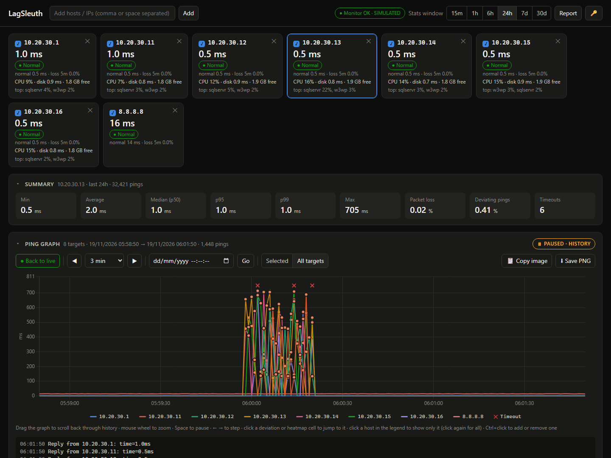
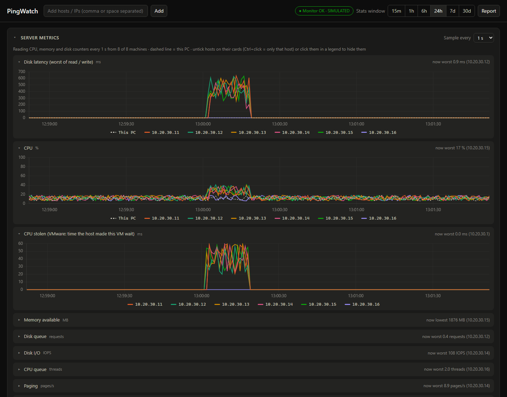
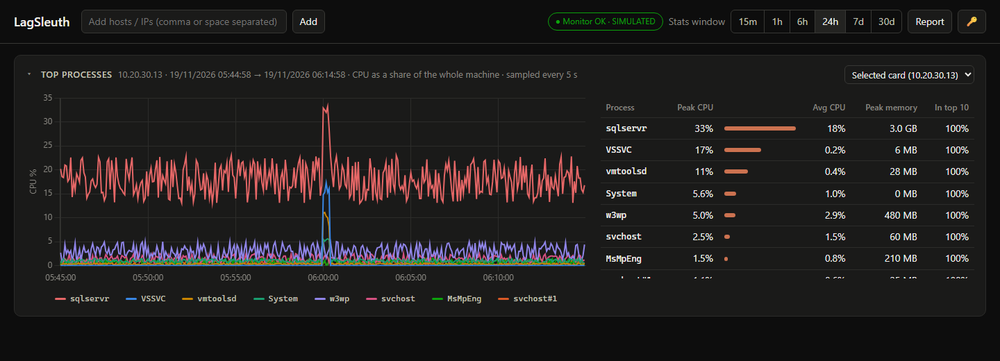
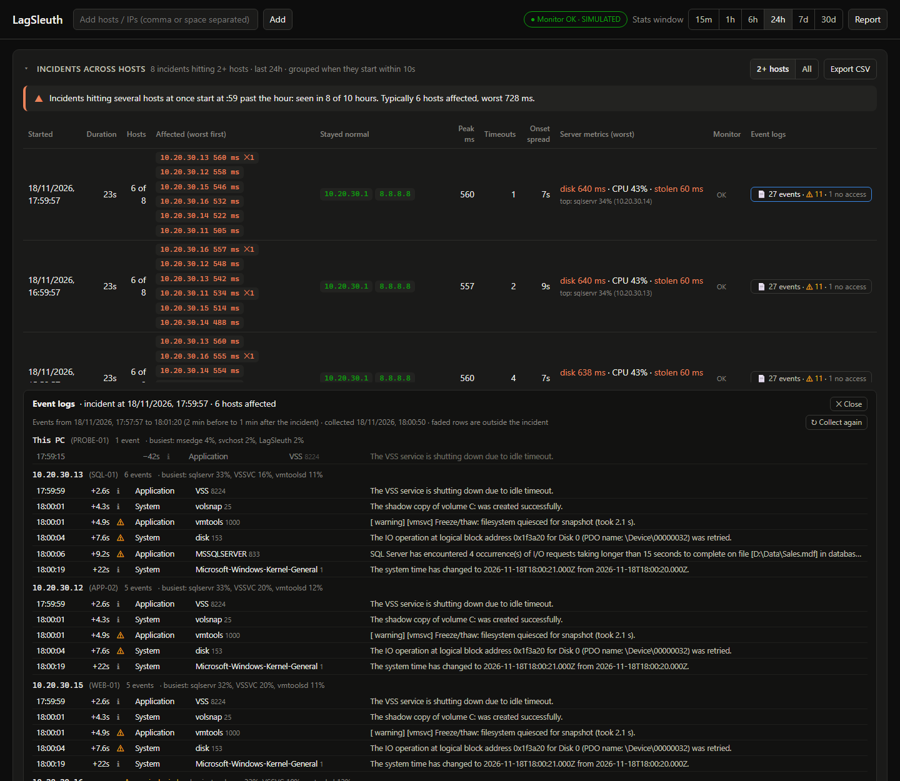
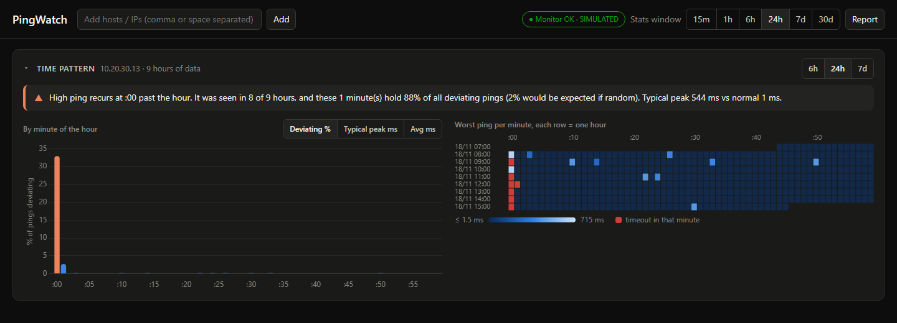
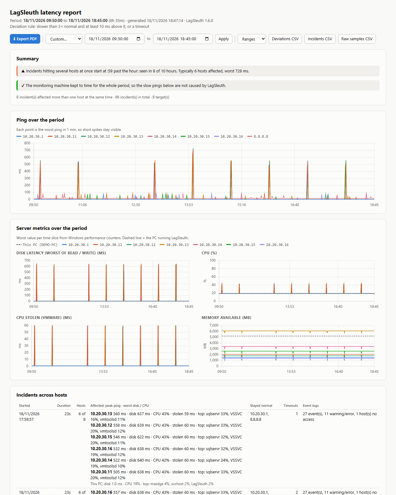

# LagSleuth

**A portable Windows network latency monitor that finds out *when* and *why* ping goes high.**

LagSleuth pings any number of hosts every second, learns what "normal" looks like for each one, and flags anything that strays from it. When several hosts go slow together it groups them into one incident, then pulls in the CPU, memory and disk counters and the Windows event logs from those servers, so you can see what was happening at that moment. It was built to track down latency spikes that hit a group of virtual machines at the top of every hour.

One exe. No install, no admin rights, no Python, no database, no internet connection needed. The web dashboard is built in.

<sub>Formerly called PingWatch. Upgrading from it? Just swap the exe: config and history carry over.</sub>

[**⬇ Download the latest release**](https://github.com/Metrognome321/LagSleuth/releases/latest)

[](https://github.com/Metrognome321/LagSleuth/raw/main/media/lagsleuth-promo.mp4)

▶ [**Download the 30-second video**](https://github.com/Metrognome321/LagSleuth/raw/main/media/lagsleuth-promo.mp4) (1080p MP4, 12 MB)

<sub>The video and screenshots use simulated, fictional hosts and data.</sub>

---

## Screenshots

**Dashboard:** a card per host with live ping, CPU, disk and top processes, and the ping graph paused on an incident where six hosts stall at once.



**Server metrics:** disk latency, CPU and VMware CPU stolen time from every server, on the same timeline as the ping graph.



**Top processes:** which applications were using the CPU, per server, over any period.



**Incidents across hosts:** one row per incident, with the hosts hit, the hosts that stayed normal, server metrics, the busiest process, and the Windows event logs from around that moment.



**Time pattern:** spots problems that come back at the same minute every hour.



**Report:** a printable report for any period, exportable to PDF.



---

## Features

### Ping monitoring
- Pings every host once a second using the native Windows ICMP API (the same one `ping.exe` uses).
- **Learns normal** for each host (median of the last ~5 minutes) and flags a ping as a deviation if it times out, or is both 3× slower than normal and at least 10 ms above it.
- **Live, scrollable ping graph** per host or all hosts overlaid: pause, drag back through history, zoom from 30 seconds to 30 days, jump to a date and time. Long periods show the worst ping per time slice, so short spikes are never averaged away.
- **Grafana-style legend**: click a host to show only that host, click again to show all, Ctrl+click to add or remove one.
- **Copy image / Save PNG** of the graph, ready to paste into Teams or an email.

### Finding the pattern
- **Incidents across hosts**: slow spells on different hosts that start together become one row, showing which hosts were hit (worst first), which stayed normal, how long it lasted and how far apart the hosts went slow (*onset spread*).
- **Time pattern**: folds every hour on top of each other to spot things like *"high ping recurs at :00 past the hour, seen in 22 of 25 hours"*, with a by-minute chart and an hour × minute heatmap.
- **Response distribution**: pie chart and table of response times (exact ms or ranges).
- **Monitor self-check**: warns if LagSleuth itself was paused, so a hiccup on the monitoring machine is never mistaken for a network problem.

### Finding the cause
- **Live server metrics, every second** (adjustable from 1 to 60 s on the dashboard): CPU, CPU queue, **CPU stolen** (VMware: time the host made the VM wait), memory available / committed / paging / ballooned, **disk read and write latency**, disk queue and IOPS. They're shown on the host cards and in collapsible graphs on the same timeline as the ping graph.
- **Top processes**: the busiest applications on each server (CPU as a share of the machine, like Task Manager, plus memory), recorded every 5 seconds. You get a live "top:" line on each card, a CPU-per-process graph with a ranking table, and the busiest process during every incident.
- **Per-incident metrics**: each incident shows every affected host's worst disk latency, CPU and stolen time.
- **Show only some servers**: untick hosts on their cards (Ctrl+click = only that one) to filter the ping graph and every metric graph. Every graph has a clickable legend.
- **Event logs around incidents**: after an incident, LagSleuth reads the Windows event logs from the monitoring PC and every affected host, from 3 minutes before it started to 3 minutes after it ended (both adjustable). It collects errors and warnings plus events that often explain a stall: clock changes, VSS / snapshots / VMware Tools, scheduled tasks, Windows Update, Storport and Time-Service, and, where Sysmon is installed, every program that started, with what launched it.

### Reporting
- **Printable report** for any period (preset or custom From / To), for every host or just the ones you pick: summary, ping graph, server metric graphs, incidents with per-host metrics and event-log counts, and a section per host.
- **Export PDF** (A4 landscape, high-resolution graphs) through the browser's *Save as PDF*.
- **CSV exports**: incidents, deviation events and every raw ping.

---

## Quick start

1. Download **LagSleuth-x.y.z-windows.zip** from [Releases](https://github.com/Metrognome321/LagSleuth/releases/latest) and unzip it anywhere.
2. Double-click **`LagSleuth.exe`**. The dashboard opens at **http://localhost:5055**.
3. Add hosts in the box at the top (paste a list separated by commas or spaces).
4. Keep the console window open while monitoring. Closing it stops LagSleuth.

Leave it running for at least 4 hours before relying on the time-pattern findings.

| Download | Use on |
|---|---|
| `LagSleuth-64bit.exe` (`LagSleuth.exe` in the zip) | 64-bit Windows 10/11 and Windows Server 2016+ (almost every machine) |
| `LagSleuth-32bit.exe` | 32-bit Windows 10 |
| `LagSleuth-ARM64.exe` | Windows on ARM (Snapdragon, Surface Pro X) |

The exes aren't code-signed, so SmartScreen warns on first run: click **More info → Run anyway**.

**Upgrading:** close LagSleuth, replace `LagSleuth.exe`, start it again. Config, history and events carry over.

**Start at logon:** put a shortcut to `LagSleuth.exe -no-browser` in `shell:startup`.

---

## Reading metrics and event logs from other servers

LagSleuth reads remote servers **as the Windows account it runs as**, with no stored passwords. If you start it while logged in with your domain account, it uses your account. On each server you want data from:

| For | Needs on that server |
|---|---|
| **Server metrics** | The account in **Performance Monitor Users** (or an admin), the **Remote Registry** service running, the **File and Printer Sharing** firewall rule allowed |
| **Event logs** | The account in **Event Log Readers** (or an admin), the **Remote Event Log Management** firewall rule allowed |

Servers LagSleuth can't read show **"no access"** with the reason, and are retried automatically. Public addresses (such as `8.8.8.8`) are never queried. If the servers are in a different domain that doesn't trust yours, use an account from that domain.

---

## Configuration

Settings live in `config.json` next to the exe (or in `%LOCALAPPDATA%\LagSleuth` if that folder is read-only). Targets added or removed in the dashboard are saved automatically. Edit the file and restart LagSleuth for other changes.

| Key | Default | Meaning |
|---|---|---|
| `targets` | `8.8.8.8`, `1.1.1.1` | Hosts / IPs to ping |
| `interval_seconds` | `1` | Gap between pings, per host |
| `timeout_ms` | `1000` | Ping timeout |
| `baseline_window` | `300` | Successful pings used to work out normal |
| `deviation_factor` | `3` | A deviation is slower than this × normal… |
| `deviation_min_delta_ms` | `10` | …and at least this many ms above normal |
| `high_ms` | `0` (off) | Anything at or above this always counts as a deviation |
| `event_close_after` | `5` | Normal pings in a row that end an event |
| `incident_window_s` | `10` | Slow spells starting this close together form one incident |
| `event_logs` | `true` | Collect Windows event logs around incidents |
| `event_log_before_s` | `180` | Event logs are read from this many seconds before an incident starts… |
| `event_log_after_s` | `180` | …to this many seconds after it ends (they are collected once that has passed) |
| `metrics` | `true` | Read CPU / memory / disk counters from the hosts |
| `metrics_interval_seconds` | `1` | How often to read them (also changeable on the dashboard) |
| `metrics_retention_days` | `7` | Metric and process history kept (about 4.5 MB + 3 MB per host per day) |
| `process_interval_seconds` | `5` | How often the busiest processes are recorded |
| `retention_days` | `30` | Ping history and events kept |
| `host` / `port` | `0.0.0.0` / `5055` | Web listener (`127.0.0.1` = this PC only) |
| `open_browser` | `true` | Open the dashboard on start |

**Command line:** `-port 8080` (different web port), `-no-browser` (don't open a browser), `-data D:\pingdata` (keep config and data elsewhere).

---

## Building from source

LagSleuth is a single Go program using only the standard library (no external modules, no CGO). The dashboard and Chart.js are embedded into the exe.

Requires Go 1.22 or newer. From the `source` folder:

```bash
gofmt -l .        # must print nothing
go vet .
go test ./...
GOOS=windows GOARCH=amd64 CGO_ENABLED=0 go build -trimpath -ldflags "-s -w" -o dist/LagSleuth.exe .
```

Use `GOARCH=386` and `GOARCH=arm64` for the 32-bit and ARM builds. On Windows PowerShell set the variables first, e.g. `$env:GOOS="windows"; $env:GOARCH="amd64"; $env:CGO_ENABLED="0"`.

**Try it without a network:** set `LAGSLEUTH_SIMULATE=1` for simulated pings, metrics and event logs, including a stall shared by several hosts every 3 minutes:

```bash
LAGSLEUTH_SIMULATE=1 go run . -no-browser -port 5077 -data /tmp/pwtest
```

| File | Contents |
|---|---|
| `main.go` | Config, storage, ping monitors, deviation detection, stats, time pattern, HTTP API |
| `incidents.go` | Cross-host incidents, incident time pattern, monitor self-check |
| `metrics.go`, `metrics_windows.go` | Performance counters (pdh.dll), storage, API |
| `processes.go` | Top processes per machine: sampling, history, API |
| `eventlog.go`, `eventlog_windows.go` | Event log collection (wevtutil) and API |
| `ping_windows.go` | Native ICMP via iphlpapi.dll `IcmpSendEcho` |
| `*_other.go` | Non-Windows fallbacks (testing only) |
| `web/index.html`, `web/report.html` | Dashboard and report (vanilla JS + bundled Chart.js 4.4.4) |
